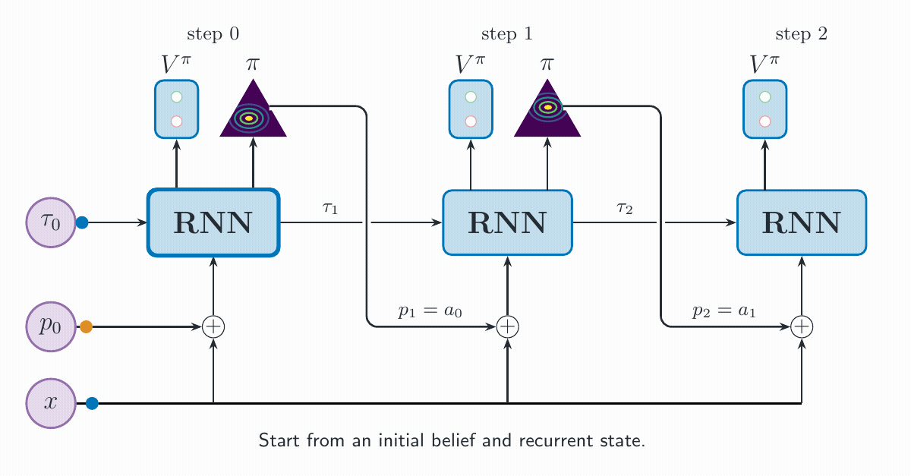

# Do Not Imitate, Reinforce: Iterative Classification via Belief Refinement

JAX implementation of Reinforced Iterative Classification (RIC), from our TMLR 2026 paper
[Do Not Imitate, Reinforce](https://arxiv.org/abs/2604.22110) ([OpenReview](https://openreview.net/forum?id=7xXijNfm8j)).
If you use our code, please cite the paper.

A classifier does not have to guess its label in one shot. RIC treats classification as a reinforcement learning
problem: a recurrent actor refines its class distribution step by step and is rewarded for every improvement, and a
critic learns when another step is no longer worth taking.



## Installation

Requires Python 3.12 or newer and [uv](https://docs.astral.sh/uv/).

```bash
git clone https://github.com/kallel-mahdi/ric.git
cd ric
uv sync --extra cuda      # CUDA 13 (NVIDIA driver >= 580); --extra cuda12 for CUDA 12; no extra for CPU
source .venv/bin/activate
```

## Usage

Train RIC-SPO on CIFAR-10:

```bash
ric-train +experiment=ric_spo dataset=cifar10
```

The baselines from the paper have their own entry points:

```bash
ric-train-sl       +experiment=sl_adamw dataset=cifar10    # cross-entropy
ric-train-edl      +experiment=edl_adamw dataset=cifar10   # evidential deep learning
ric-train-adaptive +experiment=ponder dataset=cifar10      # PonderNet (+experiment=act for ACT)
```

Datasets download on first use. Add `+sweep=paper` to run the five seeds used in the paper. Training ends by scoring
the selected checkpoints on the test split; to score a saved run again:

```bash
ric-eval --checkpoint-dir <run> --selector nll
```

The [usage guide](docs/usage.md) covers dataset preparation, sweeps, cluster runs and evaluation options.

## Citation

```bibtex
@article{kallel2026ric,
  author        = {Mahdi Kallel and Johannes T{\"o}lle and Ahmed Hendawy and Carlo D'Eramo},
  title         = {Do Not Imitate, Reinforce: Iterative Classification via Belief Refinement},
  journal       = {Transactions on Machine Learning Research},
  year          = {2026},
  url           = {https://openreview.net/forum?id=7xXijNfm8j},
  eprint        = {2604.22110},
  archivePrefix = {arXiv},
}
```

## License

[Apache-2.0](LICENSE)
